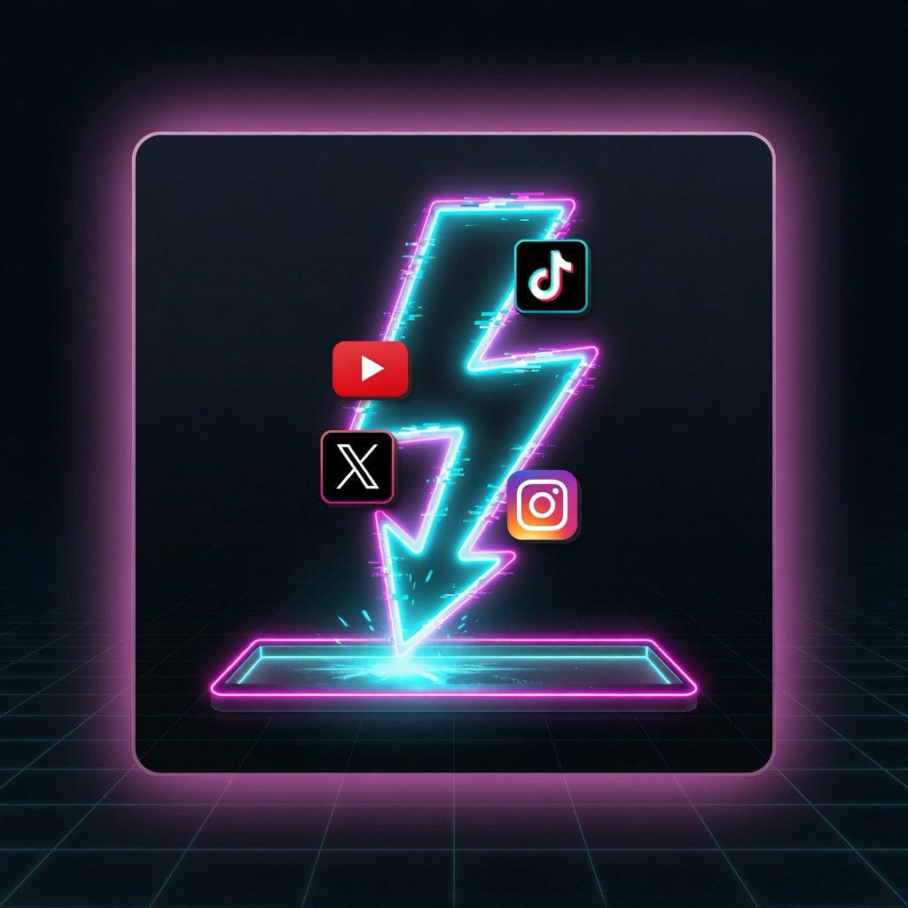

# DV Max

<p align="center">
  
</p>

Cliente de desktop para baixar vídeo e áudio com o [yt-dlp](https://github.com/yt-dlp/yt-dlp) e o FFmpeg que já estão instalados na máquina. A janela se chama DV Max. O pacote Flutter é `dv_max_easy`.

O app não embute o yt-dlp nem o FFmpeg. Os extratores mudam com frequência, e o binário que você atualiza pelo gerenciador de pacotes continua sendo o que faz o download. O DV Max monta a fila, os perfis, o progresso e as ações no arquivo.

Funciona no macOS, no Windows e no Linux. Android, iOS e web não são alvos: as pastas existem porque o Flutter as gera, e o app não baixa nada por elas.

## O que dá para fazer

- Colar um link `http` ou `https`, ou digitar e tocar em **Baixar**. Um link copiado aparece numa faixa ao abrir ou ao focar a janela. A faixa nunca começa o download sozinha.
- Acompanhar progresso, velocidade e tempo restante. Cancelar e tentar de novo, com o motivo do erro em português.
- Escolher o perfil ativo na fila. O primeiro arranque cria **Música** (só áudio, mp3) e **Filmes** (1080p, áudio em japonês e depois português, legenda em português embutida). Dá para criar outros perfis, com pasta, taxa e fragmentos concorrentes.
- Ver os concluídos com busca e filtros combinados. Um link repetido avisa que já foi baixado e não bloqueia um novo download.
- Abrir o arquivo, copiar, mostrar no Finder, no Explorer ou no gerenciador de arquivos, compartilhar e arrastar o cartão para outro aplicativo.
- Abrir a página de origem no navegador padrão.
- Cortar um vídeo já baixado: tirar começo, fim ou um trecho do meio e juntar o que sobrou. O arquivo novo fica ao lado do original, com `-corte` no nome.
- Apagar o arquivo depois de um prazo do perfil. O histórico permanece. Um arquivo pode ficar de fora desse prazo.
- Ver, na barra de baixo, arquivos na pasta, espaço usado, espaço livre e o andamento global dos downloads.
- Guardar listas de links e baixar a lista inteira de uma vez. As listas ficam salvas depois de fechar a janela.
- Converter um arquivo local (mp4, mkv, webm, avi, mpg, mp3 e outros) para MP4, MKV, WebM, MP3 ou M4A. O original permanece. Um endereço `https`, mesmo terminando em `.mp4`, continua sendo download.

A interface acompanha o tema claro ou escuro do sistema. Os textos visíveis estão em português.

## O que ainda não entra

- Unir as partes de uma playlist na ordem da lista.
- Receber um link pelo compartilhar do sistema e começar sozinho.
- Player dentro da janela. O corte é por tempo, sem pré-visualização.

## Requisitos

- Flutter com Dart 3.13 ou mais novo.
- yt-dlp e FFmpeg no computador. O `ffprobe` precisa estar na mesma pasta do FFmpeg. Sem ele o download não fecha o arquivo e o corte não lê a duração.

macOS:

```bash
brew install yt-dlp ffmpeg
```

Windows:

```bash
winget install yt-dlp.yt-dlp Gyan.FFmpeg
```

Linux: instale `yt-dlp` e `ffmpeg` pelo pacote da distribuição.

Na primeira abertura, se os programas não forem encontrados, o DV Max pede o caminho.

## Rodar

```bash
flutter pub get
flutter run -d macos
```

Troque `macos` por `windows` ou `linux` no sistema correspondente.

Atalhos, com ⌘ no macOS e Ctrl no Windows e no Linux: L foca o campo, Enter baixa, 1 a 6 trocam Fila, Concluídos, Listas, Converter, Perfis e Ajustes, vírgula também abre Ajustes, ponto cancela o download em curso. Esc dispensa a faixa do link copiado.

Fila, listas, perfis e ajustes ficam em JSON no diretório de suporte do aplicativo e continuam lá depois de fechar a janela.

## Testes

Os testes não usam a rede e não chamam o yt-dlp de verdade.

```bash
flutter analyze
flutter test
```

## Licença da fonte

A interface usa Inter, distribuída sob a SIL Open Font License. O texto está em `OFL.txt`.
